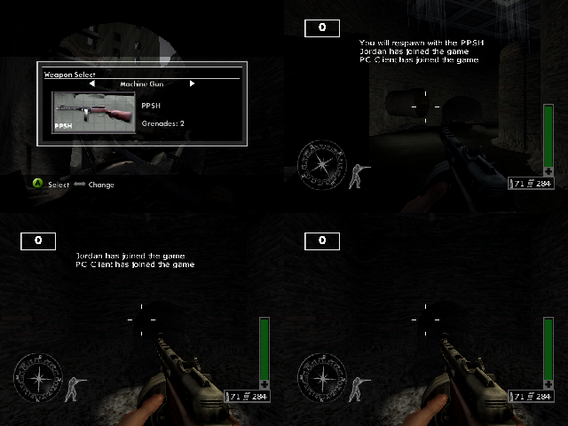
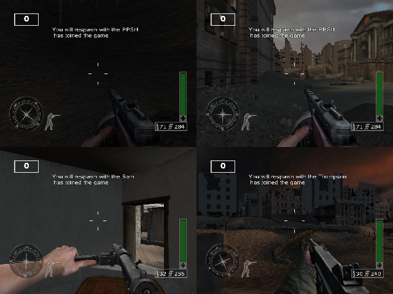

# Win32 port plan

A plan for building *Call of Duty: Finest Hour* (multiplayer executable,
`Game_XboxMultiplayer.xbe`) as a Windows x86 program from this repository's sources. State on
2026-10-05: every game, RenderWare Studio, RenderWare and RenderWare Audio function is source
(13,301 placed rows from `build/src`), and `tools/plainbuild.py` links those sources against the
installed XDK libraries with no M7 tooling. That plain build has run in xemu (menus, multiplayer
maps, and single-player levels through the research patch), which is where the facts below come
from: the plain link (`build/plain/link.rsp`, `game.map`), `src/`, a scan of the Xbox disc's
`COD.PAK`, and crash triage over xbdm.

Companion documents:

- [WIN32_PORT_API.md](WIN32_PORT_API.md): every Xbox SDK symbol the sources use, with its users
  (appendix A; regenerated by `tools/port/api_inventory.py` then `api_inventory_md.py` after a
  plain build without `--define`).
- [WIN32_PORT_ASSETS.md](WIN32_PORT_ASSETS.md): the disc's texture, geometry, world and file
  formats, measured (appendix B).
- [LATENT_BUGS.md](LATENT_BUGS.md): bugs a non-matching build exposes; the port inherits all of
  them.

## Port status (2026-10-05)

The port builds, runs and plays: `python tools/portbuild.py` compiles every unit under `src/`
(Bink included) and `port/src`, and links `build/port/codfh.exe`. Run it with the disc's files
as the data root:

    CODFH_DATA=D:\CODFH_DUMP build/port/codfh.exe [-map <n|name>] [-gametype DM|TDM|CTF|SD|SUP]

| Workstream | State | Checked by |
|---|---|---|
| W0 build, entry point | Done | Every unit compiles and links; `codfh.log` beside the executable |
| W1 platform | Done | Files (`d:\` to the data root, the pack unchanged), saves, memory (16-byte aligned heap), threads, launch, flags |
| W2 rendering | Done for everything the game draws (Direct3D 11, section 4) | Front end, all 8 multiplayer levels, first-person, HUD and menus at 60 fps; no bridge stub is reached in the front end, a match or a movie |
| W3 data | Done for textures, geometry and audio formats | The formats the bridge translates: swizzled/linear 32-bit, P8, DXT1/3/5; Xbox ADPCM and PCM; no WMA on the disc |
| W4 input | Done | XInput pads, keyboard, raw-input mouse look (`[input] mouse_sensitivity`); the mouse in the menus (`port/src/menumouse.cpp`): pointing focuses an item (or its row), a click chooses it, on a setting's arrows changes it, the right button goes back, the wheel moves up and down |
| W5 audio | Done but the DSP image's filters | Software mixer over XAudio2 (3D, mix bins, submixes, play/loop regions), I3DL2 reverb in software, WMA through Media Foundation (unexercised: the disc has none); recordings with `CODFH_WAV` |
| W6 video | Done | The Xbox Bink library from `src/bink` (C and its x86 transcriptions); the Act 1 newsreel plays with sound (`-movie Act_1.bik`) |
| W7 networking | Done for System Link | Two instances on one machine (`CODFH_NETLOOP=1`/`2`) find, join and play one match ("PC Client has joined the game" on both); Live answers "not signed in" |
| W8 polish | Done | Resizable window (4:3 letterboxed), borderless fullscreen (`[video] windowed=0`, Alt+Enter), clean close, key rebinding (`[keys]`), crash reports with symbols in `codfh.log` |

The renderer's translations, all in `port/src/d3d`: the Xbox's vertex microcode to HLSL
(`xvsh.cpp`, with the screen-space epilogue and the reserved viewport constants c[-38]/c[-37]),
the vertex-shader assembler and splicer the skin pipeline uses (`xvasm.cpp`), the register
combiners to HLSL (`xdraw.cpp`, `xbox_pixel_shader`), the fixed-function vertex and texture-stage
pipelines as generated shaders, cached by state; the game's gamma ramp is applied in the final
pass (`pd11.cpp`).

Frames whose work takes over 25 ms are logged with the shaders compiled and textures uploaded in them.
Compiled shaders are kept in `%LOCALAPPDATA%\CODFH\shaders` (each compiles once, not at its first
draw in every run).

Configuration (`codfh.ini` beside the executable): `[video] width height windowed vsync
widescreen render_scale` (the frame drawn at 640x480 times `render_scale`; 0, the default, is as
large as the window holds, up to 4x), `[video] adapter` (a part of the GPU's name; by default the high-performance
GPU, the discrete one where there are two: the executable also exports `NvOptimusEnablement` and
`AmdPowerXpressRequestHighPerformance`), `[game] language name`, `[input] mouse_sensitivity`, `[keys]` (an action, then keys: `fire = MOUSE1, CTRL`; the actions are
`port/src/xpal_sys.cpp`'s binding table), `[data] root user`.

Debugging switches (environment): `CODFH_SHOT=n` (frame n to `shot.bmp`; `CODFH_SHOT_EVERY=1`
every n frames; `CODFH_SHOT_WINDOW=1` the window's buffer), `CODFH_INPUT=frame:button,...`
(scripted pad presses), `CODFH_DRAWID=n` (frame n's draws as flat colours naming them, each
logged; `CODFH_DRAWDETAIL=k` logs draw k's vertices, constants and textures),
`CODFH_NODEPTH`, `CODFH_NOCULL`, `CODFH_NOFOG`, `CODFH_WIREFRAME`, `CODFH_STATS`,
`CODFH_TRACE=n` (frame n's device calls), `CODFH_WAV=file` (the mixed audio), `CODFH_NETLOOP=n`
(System Link on 127.0.0.n), `CODFH_PROFILE=1` (a sampling profiler: each slow frame's functions, most first).

The overlay (`CODFH_IMGUI`, on in the game's build; `--no-imgui` leaves it out, the dedicated server
never has it): Dear ImGui 1.92.9 (`port/third_party/imgui`, MIT) drawn over the finished frame. F1
shows it (`CODFH_OVERLAY=1` from the start): frame time and rate, the renderer's draws, vertices,
untextured and dropped draws and its timings, the wireframe / no depth / no culling / no fog
switches live, and the mouse sensitivity. Captures (`CODFH_SHOT`) leave it out unless
`CODFH_SHOT_WINDOW=1`.

Open: the DSP image's other effects (filters; the game sets reverb off), a two-PC LAN test (the loopback test covers the same code), single-player content (section 13).






## 1. Goals and rules

- **Goal:** a 32-bit Windows executable that runs the game **directly from the original disc's
  Xbox data**, rendering through Direct3D 9, with keyboard/mouse and XInput pads, audio,
  video, saves, and LAN multiplayer.
- **The port is done in a separate directory** (its own checkout/worktree of this repository).
  Its own new files (the platform layer, build scripts, port configuration) live there.
- **Every Win32 change to a shared source is behind `#ifdef CODFH_WIN32`.** No shared file
  changes its Xbox meaning: with `CODFH_WIN32` undefined, every file preprocesses to what it is
  now. The placement-link gate (`tools/ibuild.py`, `== PASS`) and the M7 rebuild
  (`m7retail.py`, `== IDENTICAL`) must keep passing on the port's branch, so port work can merge
  back without touching the matching results.
- **The port is built on the plain build.** It defines `CODFH_PLAIN` as well as `CODFH_WIN32`:
  every plain-build fix (section 3) applies to it unchanged.
- **Native Xbox data, unchanged.** The game, RenderWare and RenderWare Audio parse the disc's
  streams exactly as on the Xbox (Xbox texture dictionaries, the Xbox vertex-format geometry
  extension, Xbox native geometry, Xbox sound banks, Bink movies). No asset conversion, no
  converter tool, no PC-format files: only the lowest layer (where the Xbox build hands data to
  Xbox D3D or DirectSound) translates resources for the PC APIs, at load time.
- **No game data in the repository.** The user points the port at their own disc data (the
  disc's `COD.PAK`, or an extracted tree).
- **Non-goals for the first release:** Xbox Live features (matchmaking service, friends, Live
  UI, voice chat), 64-bit builds, byte-for-byte timing behaviour.

## 2. What the code uses (measured)

Every external symbol our 637 objects take from an SDK library (appendix A has each symbol and
its users):

| Library | Symbols | Source files | Where | Port impact |
|---|---|---|---|---|
| d3d8 (Xbox D3D) | 106 | 35 | 24 RenderWare, 11 game | The largest surface: device, textures, vertex/pixel shaders, render-state globals, push buffers |
| xapilib (XAPI) | 52 | 27 | game, RW, RWA | Mostly Win32 already; Xbox-only: input, saves, signatures, launch info, video/audio flags, physical memory |
| dsound (Xbox) | 41 | 5 | `src/rwa/xbox`, `unit_0824A0`, `unit_1C6AC0` | A new audio backend |
| xonline (XOnline + XNet + Winsock) | 41 | 9 | game | Shimmed: real Winsock, XNet over plain IP, the minimum XOnline for System Link; Live-only calls stubbed (W7) |
| uix (Live UI) | 26 | 3 | `unit_19BF20`, `unit_2261C0`, `unit_228D70` | Stubbed: no Live UI (W7) |
| xvoice (XHV) | 18 | 1 | `unit_1C6AC0` | Stubbed: no voice device (W7) |
| xgraphics | 17 | 6 | game, RW | XFONT debug text, shader assembly/splicing, swizzle helpers, texture headers |
| binkxbox | 11 | 2 | `unit_19CB20`, `unit_19CD50` | Win32 Bink or another Bink decoder |
| xboxkrnl | 3 | 9 | everywhere | `Rtl*CriticalSection` → Win32 critical sections |
| d3dx8 | 3 | 3 | game, RW | Matrix helpers: D3DX9 or own math |
| libcmt / libcpmt | 86 / 2 | 499 / 132 | everywhere | None: the Windows CRT |
| **All but the CRT** | **318** | **70** | 33 game units, 27 RW, 8 RWA, 2 RWS | |

Notes from the inventory:

- 34 of the 106 d3d8 symbols are the `D3DDevice_SetRenderState_*` / `SetTextureState_*`
  handlers, all named by the inline `D3DDevice_SetRenderState` switch whenever the state index is
  not a constant. The bridge needs only the states actually set (inventory: W2.6).
- D3D **globals** used directly: `D3D__RenderState`, `D3D__DirtyFlags` (11 files each),
  `D3D__TextureState`, `D3D__pDevice` (`unit_19B0F0`, `unit_19CD50`), `D3D__Device`
  (`skinxboxrender.c`). The bridge must provide them as real storage and honour the dirty flags.
- **Raw push-buffer writes** (`D3DDevice_BeginPush/EndPush`, `MakeSpace`, `BeginStateBig`) in
  `xbdevice.c`, `xbsprite.c`, `nodeXboxSubmitNoLight.c`: GPU commands written by hand; each
  site is rewritten as D3D9 calls under `#ifdef`.
- The game never calls `XNetStartup`/`WSAStartup` itself: `XOnlineStartup` starts the stack.
- Other touchpoints: inline assembly in `unit_19CD50` (FPU control word), `unit_1A8B20`,
  `unit_1F81E0`, RW's `bamatrix.c`/`bavector.c`, `xb2drend.c`, `xbvtxfmt.c`, `ptankxbox.c`,
  `rwatimer.c`: all x86/MMX/SSE, building unchanged for Win32 x86. 36 files include Xbox headers
  (`xtl.h`, `xonline.h`, `xgraphics.h`, `dsound.h`).
- Reference code on this machine: RenderWare 3.7.2's d3d8/d3d9 drivers and pipelines
  (`D:\RW_372_src\RWSDK`), RenderWare Studio's `win32` and `xbox` framework folders side by side
  (`C:\rwstudio\Studio\console\game_framework`), DirectX SDKs Oct04 (D3D9 headers for VC7.1)
  through Jun10.

## 3. Starting point: the plain build and its latent bugs

The port is the plain build plus Win32. Running the plain build showed that a normal link breaks
things the placement link hides (details and status: [LATENT_BUGS.md](LATENT_BUGS.md) A):

- names that are second names for another variable's bytes (171, bound as references under
  `CODFH_PLAIN`);
- buffers declared smaller than the image's (the script VM's argument stack; `byte_44E490`,
  a 0x100-byte subtitle buffer declared as one byte);
- SSE data needing 16-byte alignment that VC7.1 drops in `.bss`;
- `memset`s across several image variables.

The port adds its own risk of the same kind: a different compiler, allocator and heap layout move
every overrun to a new victim. Before W2:

1. **Audit scalars that are really buffers:** every global whose declared size is smaller than
   the gap to the next image variable and whose address is taken or written through
   (`strcpy`/`sprintf`/`memcpy` targets, casts to arrays). Size each from its uses, fix under
   `CODFH_PLAIN`. A tool alongside `tools/session/overlapvars.py`.
2. **Run the plain build through every mode** (front end, each multiplayer map in each game type,
   level restarts, many respawns) in xemu before porting; crashes there are cheaper to find on the
   Xbox build than on the port.
3. **Fix the B list** in LATENT_BUGS.md that the port will hit in normal play (none is hit in the
   shipped game's normal play, but the port changes timing and memory): at least the
   pool-exhaustion paths and the respawn-gap NULL-player reads.

## 4. Renderer decision: the Xbox RenderWare driver on Direct3D 9

**Keep our recovered Xbox RenderWare driver, pipelines and plugin variants, and port their device
calls from Xbox D3D to Direct3D 9** (all inside `#ifdef CODFH_WIN32`). Do not swap in
RenderWare's stock d3d8 or d3d9 driver.

- RenderWare's stream data is **driver-specific**. The disc carries Xbox native rasters (15,695
  texture natives, all `rwID_XBOX`), the Xbox vertex-format extension (0x511) and Xbox native
  geometry (0x510: 7,355 geometries and 2,020 world sectors stored as ready Xbox vertex and index
  buffers, with no generic vertex arrays). The stock PC drivers read only their own platforms'
  chunks and would need every asset converted, which the rules exclude.
- **Direct3D 9 rather than 8 underneath:** the generated skinning shaders run in the Xbox's
  192-constant mode (`skinxboxconstantmode.c`): D3D9's `vs_2_0` has 256 constants, D3D8's
  `vs.1.1` 96. D3D9 is also the better-supported runtime on current Windows. D3D8 is the closer
  API (Xbox D3D derives from it), but the remaining differences are mechanical.

RenderWare's stock d3d9 driver stays the reference for device creation, resource management,
device-lost handling and shader set-up.

**Revised 2026-10-05 (owner): Direct3D 11 underneath, not 9.** Measured on the development
machine over Remote Desktop: Direct3D 9 sees no adapter (`CreateDevice` gives
`D3DERR_INVALIDCALL`, 9Ex `D3DERR_NOTAVAILABLE`), while Direct3D 11 creates a GPU device at
feature level 11_0 and WARP always works. The bridge keeps the Xbox API on its Xbox side
(`port/src/d3d/d3d8_bridge.cpp`); only its back end (`pd11.cpp`, behind `pdev.h`) sees Direct3D
11. Shaders become HLSL `vs_4_0`/`ps_4_0` (constant buffers remove the 192-constant limit); the
fixed-function paths (lights, materials, texture stages) are emulated with shaders, as the stock
d3d9 driver's shader paths show. Where this document says Direct3D 9 below, read the back end.

## 5. Architecture

```
game (src/recovered, src/COD, src/Source)       unchanged except #ifdef CODFH_WIN32 blocks
  |
RWS framework (src/rws)                          win32 branches after RW Studio's win32 folder
  |
RenderWare 3.6 core + Xbox driver/pipes/plugins  stream readers unchanged; device calls under
  |                                              #ifdef CODFH_WIN32 go to the D3D9 bridge
RenderWare Audio core + Xbox backend             stream readers unchanged; DirectSound calls
  |                                              under #ifdef go to the audio bridge
port layer (new, port directory)
  xpal: files, saves, input, timing, launch, flags, memory, threads
  d3d9 bridge: Xbox D3D surface -> Direct3D 9 (textures, vertex data, shaders, states)
  audio bridge: Xbox DirectSound surface -> XAudio2 (voices, mix bins, I3DL2, codecs)
  |
Win32 + Direct3D 9 + XAudio2 + Winsock + Bink decoder
```

- **The bridges keep the Xbox API surface.** Where the Xbox code calls `D3DDevice_SetTexture`,
  `D3DTexture_LockRect`, `IDirectSoundBuffer_SetMixBins` and so on, the port build provides
  those names (`port/include/xtl_win32.h` and friends, ahead of the XDK headers on the include
  path), implemented over D3D9/XAudio2. Most of the Xbox driver then compiles unchanged; `#ifdef`
  blocks are needed only where the Xbox code relies on Xbox-only behaviour (push buffers,
  swizzled memory, screen-space shaders, physical memory shared with the GPU).
- **Build:** `tools/portbuild.py` in the port directory, modelled on `tools/plainbuild.py`:
  `/DCODFH_WIN32 /DCODFH_PLAIN /D_WIN32`, Win32 SDK and DirectX include paths with the bridge
  headers first; links `/SUBSYSTEM:WINDOWS` against `kernel32 user32 gdi32 winmm d3d9 xaudio2
  ws2_32` (no XDK library). The matching build's `config/flags.txt` rules are not changed.
- **Compiler:** VC7.1 (the project's toolchain) with the Oct04 DirectX SDK first; a current MSVC
  once the port runs (conformance fixes behind `#ifdef CODFH_WIN32`, or conformance-neutral
  rewrites that keep the Xbox build byte-identical).

## 6. Start-up, frame and shutdown order, with the port's action at each step

From the code (file:line in the start-up inventory this table condenses).

### 6.1 Start-up

| # | Step | Where | Xbox calls | Port action |
|---|---|---|---|---|
| 1 | Launch data: settings from the other title (`LDT_TITLE`), profile slots copied | `unit_19CD50.cpp:251-285`, `unit_1A16D0.cpp:566` | `XGetLaunchInfo` | Read a launch file (written by the port when it "launches" itself); none = zeroed, as from the debugger |
| 2 | Save/profile state defaults (language, pad, difficulty) | `unit_19AAB0.cpp:168` | none | none |
| 3 | 640x480x32; `RwXboxDeviceConfig` from the video flags (refresh, multisample 0x11, interval, widescreen/480p/720p flags) | `unit_19CD50.cpp:287-345` | `XGetVideoFlags`, `XGetVideoStandard`, `Direct3D_EnumAdapterModes` | Config file: resolution, window/fullscreen, widescreen, vsync, MSAA; the device config struct is filled from it |
| 4 | Audio flags, device enumeration init | `unit_19CD50.cpp:295-296` | `XGetAudioFlags`, `XInitDevices` | Config speaker set-up; input module init |
| 5 | Stopwatch | `unit_19B0F0.cpp:417` | `QueryPerformance*` | unchanged |
| 6 | 4 critical sections | `unit_0811C0.cpp:738` | `RtlInitializeCriticalSection` | `InitializeCriticalSection` |
| 7 | FPU to truncate (inline asm); debug font | `unit_19CD50.cpp:217` | `XFONT_OpenDefaultFont` | Keep the FPU word (the game relies on truncation); small bitmap font |
| 8 | RW memory functions (RWS malloc wrappers), `RwEngineInit` | `unit_0D99F0.cpp:50-66` | CRT | unchanged |
| 9 | RWS plugins attached | `attachplugins.cpp:44` | none | unchanged |
| 10 | `RwEngineOpen` → `XbDeviceSystemOpen`: Direct3D object, mode match, denormal flush | `xbdevice.c:208-280` | `Direct3DCreate8`, `Direct3D_GetAdapterModeCount/EnumAdapterModes`, `_mm_setcsr` | `Direct3DCreate9`, adapter mode enumeration |
| 11 | Push buffer 4 MB / 32 KB kick-off | `unit_0D99F0.cpp:81` | `Direct3D_SetPushBufferSize` | no-op |
| 12 | `RwEngineStart` → device: DISCARD swap, 1 back buffer, auto D24S8, 640x480, hardware vertex processing; render states, physical-memory manager, rasters, Im2D shaders | `xbdevice.c:284-319`, `xbmemory.c:629`, `xb2drend.c:108-122` | `Direct3D_CreateDevice`, `GetRenderTarget/GetDepthStencilSurface`, `XPhysicalAlloc`, `CreateVertexShader` x3 | `CreateDevice` (windowed or fullscreen, the configured size with the 640x480 2D layer scaled), device-lost handling, D3D9 Im2D shaders |
| 13 | First frame: a blank camera flipped once | `unit_0D99F0.cpp:84-88` | `Present` | unchanged through the bridge |
| 14 | Image loaders, matrix tolerances | `unit_0D99F0.cpp:90-95` | none | none |
| 15 | Pads enumerated and opened | `unit_19D920.cpp:263-275, 358-359` | `XGetDevices`, `XInputOpen`, `XInputGetCapabilities` | Input module (W4) |
| 16 | RenderWare Audio opened (1 MB + 512 KB) | `unit_0824A0.cpp:790`, `src/rwa/rwabase.c:425` | none | unchanged |
| 17 | File system: `d:` mounted as RW's Xbox file system; `d:\COD.PAK` read, its directory loaded, **RW's file interface replaced** (fopen/fread/fseek... by path hash) | `unit_19CD50.cpp:41-75`, `unit_16C800.cpp:72-115`, `src/rw/tool/fsyst/xbox/rtfsxxbx.c` | `RtXboxFSystemInit("d:")`, `CreateFileA/GetFileSize/ReadFile` | Map `d:\` to the data root. With the disc's `COD.PAK` the pack layer works unchanged; with an extracted tree, compile the pack hook out and let RW's Win32 file system read files by name |
| 18 | Audio output: `d:\data\dsstdfx.bin` (the DSP effects image) read, 3 MB output stream, listener, 36 voice streams; DirectSound created, DSP image downloaded | `unit_0824A0.cpp:735-787`, `src/rwa/xbox/unit_24DF20.c:748, 836-840` | `DirectSoundCreate`, `DirectSoundUseFullHRTF`, `DownloadEffectsImage`, `SetMixBinHeadroom` | XAudio2 engine, mastering voice, submixes per mix bin; the DSP image is not run: the effects it provides are rebuilt (W5) |
| 19 | Log callback, debug text, language; the network game object on UDP port 0x3F9; **online library started**; DirectSound and DSP image handed to the voice manager; Live UI singleton | `unit_1A26F0.cpp:216-266`, `unit_1A8B20.cpp:576-620`, `unit_1D8370.cpp:151` | `XOnlineStartup` | The XOnline shim: `WSAStartup`, then success; voice and UIX stubs report no device / no Live (W7) |
| 20 | Front end: world, camera, `Rt2dOpen`, shell manager | `unit_0DA290.cpp:62-112` | none | none |
| 21 | Shell (kujuUI): `F_FEND.TXD`, font, profile load | `unit_1A2A80.cpp:221-248`, `unit_0D9CF0.cpp` | `XFindFirstSaveGame`, `XCreateSaveGame`, `XDeleteSaveGame`, `XCalculateSignature*` (`unit_1A16D0.cpp:110-362`) | Saves module (W1) |
| 22 | Front-end loop: network tick, dt, pads, events, clear, UI draw, present (vsync) | `unit_1FBBF0.cpp:121-197` | `Present` | unchanged through the bridge |
| 23 | Client waits for the host's level directive | `unit_1B46B0.cpp:1613` | none | none |
| 24 | Game-loop init: `RWS::MainLoop::Open` (cameras, Rt2d, handlers) | `unit_0D6640.cpp:225-261` | none | none |
| 25 | Modules, including the **loading thread** (256 KB stack, priority -2) | `unit_0D6640.cpp:277-366`, `unit_0811C0.cpp:167, 764` | `CreateThread`, `SetThreadPriority`, `ResumeThread` | **Fix:** the loader is suspended and resumed through its thread *id* cast to a `HANDLE` (`unit_0811C0.cpp:167, 760-766`); keep the real handle under `#ifdef` |
| 26 | Gamma ramp from settings, soft display filter, DDS texture read callback | `unit_19CD50.cpp:104-128` | `D3DDevice_SetGammaRamp`, `SetSoftDisplayFilter` | `SetGammaRamp` (or a post-process); filter ignored |
| 27 | Level load: loading screen (drawn and presented twice), then GLOBAL.DFF, LEVEL.DFF, LEVEL.RWS, GODDATA.DFF through RwStream | `unit_0D7F20.cpp:201-289, 484`, `unit_0E8F40.cpp:223-290` | file I/O only | none |
| 28 | Game loop | `unit_0D95A0.cpp:230` | none | none |

### 6.2 In-game frame (`sub_D7410` → `sub_D7880` → `sub_125F20`)

| Step | Where | Xbox calls | Port action |
|---|---|---|---|
| Loop until `dword_4B86F8` bit 4; restart, reinit and level change handled here | `unit_0D6640.cpp:660-695` | none | Window messages pumped here too; a close request sets bit 4 |
| Frame delta from `RWS::Time::GetTime` | `gftime.cpp:13` | `GetTickCount` | Keep; `timeBeginPeriod(1)` for resolution; see W8 for frame pacing |
| Pads polled, rumble | `unit_19D920.cpp:78, 95, 411` | `XInputGetState`, `XGetDeviceChanges`, `XInputSetState` | Input module |
| Level-start state machine (`sub_D7570`), network tick, shell/HUD, `RWS::MainLoop::Poll` (logic), game systems, audio update | `unit_0D6640.cpp:814-864` | network calls | none beyond W5/W7 |
| Render (`sub_125F20`): the loading thread suspended, world, effects, frame-end pass (back-buffer overlay quad), particles, decals, `RWS::MainLoop::Render::Poll`, first-person view (own FOV and Z clear), fades, HUD, debug text; thread resumed | `unit_125490.cpp:563-711`, `unit_19B0F0.cpp:334-405` | `SetRenderState(D3DRS_ROPZCMPALWAYSREAD)`, `GetBackBuffer`, FVF `SetVertexShader`, `QUADLIST` draws, `Suspend/ResumeThread` | Xbox-only state ignored; QUADLIST → indexed triangle lists; the suspend/resume pair kept with the real handle |
| Present (interval ONE) | `xbdevice.c:518-540` | `Present` | `Present`; vsync from config |

### 6.3 Shutdown and exits

| Path | Where | Xbox calls | Port action |
|---|---|---|---|
| Game-loop exit (credits movie on the second) | `unit_0D7F20.cpp:508-528` | none | none |
| Module shutdown, `MainLoop::Close`, leak check | `unit_0D6640.cpp:496-629` | none | none |
| Engine shutdown (network, audio, pads, `RwEngineStop/Close/Term`): **effectively unreachable** (needs `byte_4F61F0/F1`, which nothing sets) | `unit_0D99F0.cpp:127-172` | `XInputClose`, DSP shutdown, D3D release | **Make it reachable** on window close (device and audio must be released on PC) |
| Quit to `d:\default.xbe` (the single-player executable) with launch data, after saving the Live logon state and persisting the display | `unit_20AA10.cpp:96-121` | `XOnlineSaveLogonState`, `D3DDevice_PersistDisplay`, `XLaunchNewImage` | Exit to desktop (or run a single-player port if one exists); `PersistDisplay` no-op |
| Not enough save blocks: to the dashboard's memory screen | `unit_18AF40.cpp:1251-1280` | `XLaunchNewImage(LD_LAUNCH_DASHBOARD)` | A message box; saves on PC have no block limit, so the check can be bypassed |
| Online shutdown | `unit_1D8370.cpp:163` | `XNetUnregisterKey` | stub |

Bink: opened at `unit_19CB20.cpp:112-135`, frames blitted at `unit_19CD50.cpp:423-433`
(`GetBackBuffer` + `LockRect(D3DLOCK_TILED)` + `BinkCopyToBuffer`), torn down with
`BlockUntilVerticalBlank` + `EnableOverlay(FALSE)`; Bink sound creates its own DirectSound
(`src/bink/binkds.cpp:545`).

## 7. What the renderer must handle: the disc's data (measured)

From a scan of the Xbox data (appendix B; `tools/port/scan_assets.py`): the disc's `COD.PAK`
and its extracted copy `C:\codfh\GameData\Extracted` give identical figures. (A tree at
`D:\FH_Extract` holds **PlayStation 2** platform textures, not this data.)

**Textures.** 15,695 RenderWare texture natives in 2,969 dictionaries, all Xbox platform, all
`TEXTURE` rasters (swizzled):

| Xbox format | Textures | Share | Largest | Pixel data | D3D9 handling |
|---|---|---|---|---|---|
| P8 (swizzled, PAL4 8,493 / PAL8 6,955; palette 888 or 8888) | 15,448 | 98.4 % | 512x512 | 232.8 MB | Unswizzle, then expand to A8R8G8B8 at load (D3D9 drivers rarely support `D3DFMT_P8`); or keep L8 + a palette texture with a `ps_2_0` lookup to save memory |
| X8R8G8B8 (swizzled) | 169 | 1.1 % | 512x512 | 32.1 MB | Unswizzle, copy |
| A8R8G8B8 (swizzled) | 78 | 0.5 % | 256x256 | 2.1 MB | Unswizzle, copy |

- No DXT-compressed, cube or non-power-of-two RenderWare textures; maximum 512 on a side. Mip
  levels: 14,652 single-level, the rest 5-10 levels (mip chains swizzled per level).
- 154 DDS images (DXT5 145, DXT1 8, one RGB32), 97 as plain files and the rest inside game
  archives, loaded through the game's DDS read callback: standard PC DDS, usable as they are.
- Unswizzling is one function (Morton order, the inverse of `XGSwizzleRect`), written for the
  port; locked rasters the code writes into keep an Xbox-layout shadow copy, unswizzled on unlock.

**Geometry.** 7,764 geometries (3,366 clumps): 7,355 **Xbox native** (instanced Xbox vertex and
index buffers in the 0x510 chunk, no generic vertex data), 409 generic. Vertex formats (0x511):

| Elements | Stride | Count |
|---|---|---|
| position FLOAT3, normal NORMPACKED3, uv FLOAT2 | 24 | 5,561 |
| position FLOAT3, normal NORMPACKED3, diffuse D3DCOLOR, uv FLOAT2 | 28 | 1,693 |
| position FLOAT3, diffuse D3DCOLOR, uv FLOAT2 (worlds) | 24 | 870 |
| position FLOAT3, normal NORMPACKED3 | 16 | 97 |
| position FLOAT3, normal NORMPACKED3, diffuse D3DCOLOR | 20 | 4 |

- **The only element type without a D3D9 equivalent is `NORMPACKED3`** (11:11:10 signed
  normalized; D3D9's `DEC3N` is 10:10:10 and optional). The bridge expands it when it creates the
  vertex buffer from the native data: to `SHORT4N` (+4 bytes per vertex) or `FLOAT3` (+8). Every
  other element (FLOAT3, FLOAT2, D3DCOLOR) maps directly. Strips (7,184 geometries, 1,976
  sectors) and lists (171, 44) map directly; 16-bit indices.
- Skins: 4,064 Xbox native (maximum 56 bones; 1-3 weights per vertex; a second stream of weights
  and indices, strides 3/6/9 bytes) and 149 generic. 56 bones x 3 constants fit `vs_2_0`.
- No morph targets beyond one per geometry; all geometries carry normals and triangle strips.

**Worlds.** 1,257 worlds, 10,317 atomic sectors (4,849 with vertices), 2,020 sectors with Xbox
native data, 870 worlds with the Xbox vertex format; collision data in 2,829 sectors (CPU only).

**Files.** `COD.PAK` has 1,372 entries (paths stored only as hashes); 947 contain RenderWare
chunks: level streams (`LEVELS\<level>\LEVEL.RWS`, `LEVEL.DFF`, `GLOBAL.DFF`,
`SECTIONS\S_<n>.RWS`), texture dictionaries, weapon and clump banks (`WPNBANK\...\wbank_NN.bin`,
`Clumps\cbank_NN.bin`). The rest: 97 DDS files and one DDS archive, layouts, font metrics and
bitmap fonts, language tables, one `SNR1` sound file. Outside the pack, on the disc root: the sound
banks (`SB_AWD`, `SB_AGD`: RenderWare Audio wave and group dictionaries), `AUDIO`, `SHELL\MOVIES`
(Bink), `data\dsstdfx.bin` (the DSP effects image), and the three vertex-shader microcode files
(`particle.xvu`, `clones.xvu`, `clonesPL.xvu`). The audio codecs (PCM, Xbox ADPCM, WMA) are not
yet inventoried (W3.3).

## 8. Shaders (inventory and plan)

The pixel side is small; the vertex side is the work.

**Vertex programs.**

| Shader | Where | Form | Plan |
|---|---|---|---|
| Im2D x3 (textured+coloured, untextured, uncoloured) | `xb2drend.c:29-122` | Precompiled Xbox microcode, 3-4 instructions, c0 scale / c1 offset | Rewrite in HLSL; trivial |
| Skin dummy | `skinxboxformat.c:66, 187` | 1-instruction placeholder bound to each skin declaration | Not needed |
| **Generated skin shaders** | `skinxboxrender.c:946-1323` (generator), `:1381` (256-entry LRU cache), 11 microcode fragments `:36-145` | `XGAssembleShader` of `xvs.1.1` text + `XGSpliceVertexShaders` at run time; 192-constant mode with negative constant indices (c[-96] viewport, c[-95..-92] matrices, lights from c[-90], 3 per bone) | HLSL permutations keyed by `{weights 1-3, directional lights, point lights, prelit}` (only the plain skin pipe is linked: no matfx/bnt variants); constants rebased to 0..255; weights and indices from the second stream converted |
| **`particle.xvu`** | loaded `unit_19E500.cpp:129, 454-470`; drawn `:768-775` | Microcode file from the disc; up to 100 constants (colours, sizes, UVs, a 32-entry spin-matrix table, matrices) | Disassemble (the Xbox `xvs` instruction set is documented by the XDK headers and community disassemblers), rewrite in HLSL; QUADLIST → indexed lists |
| **`clones.xvu`, `clonesPL.xvu`** | `unit_122FB0.cpp:186-187, 991, 1011` | Microcode files; c0-c3 WVP, c4/c5 colours, c6 light direction (lit), c7 zero | Disassemble, rewrite (lit and prelit) |
| Fixed-function declarations (world/atomic per vertex format, dmorph, matfx bump with CPU-computed UVs in stream 1, ptank) | `xbvtxfmt.c:1356-1504`, `dmorphpipeg.c:444-737`, `effectPipesXbox.c:403-457`, `ptankxbox.c:157` | Xbox declarations with no program | D3D9 vertex declarations after the NORMPACKED3 expansion; fixed-function T&L |
| FVF "shaders" x5 (Im3D, optimised ptank, the full-screen overlay) | `nodeXBoxSubmitNoLight.c:32-33`, `ptankxboxopt.c:81-87`, `unit_19B0F0.cpp:404` | FVF as the shader handle | `SetFVF` |

**Screen-space output.** Every Xbox *programmable* vertex shader writes `oPos` in screen space
using viewport scale/offset constants (`D3DDevice_GetViewportOffsetAndScale`); D3D9 expects clip
space. Each rewritten shader outputs clip space instead (and the constants that carried the
viewport transform are dropped).

**Pixel shaders.** 8 live register-combiner definitions (`D3DPIXELSHADERDEF`), all in matfx
(`effectPipesXbox.c:67-165`): environment map with and without base, emboss bump with and without
material colour, bump + environment map in four variants. 2-5 combiner stages, `PROJECT2D` only,
no dependent reads: each fits `ps_1_1`/`ps_2_0`, hand-translated. One more definition in
`xbpixelshader.c:24` is unreferenced; the per-material pixel-shader slot is never set. Everything
else, including every game effect, is fixed-function texture stages. **No game unit creates a
pixel shader.**

## 9. Workstreams

Effort for one experienced engineer with this repository's tooling and the disc data.

### W0. Port directory, build, entry point (1-2 weeks)

1. The port worktree; `tools/portbuild.py` (section 5); a `port/` directory for the bridge
   headers and the platform layer.
2. Compile everything with the bridge headers; the error list per file is the task list for
   W1/W2/W5 (expect the 36 files that include Xbox headers first).
3. `WinMain`: window, config, data root, then the game's `main` path (section 6.1 step 1 on).
4. Logging: the game's debug prints are empty functions in the retail build (`sub_19A750`) or go
   through `OutputDebugStringA` (`sub_1C8A30`, `sub_1D5D30`); route them to a log file
   (the research build's log work shows the hooks).
5. CI on the port branch: the port build, plus the gate and the M7 check.

**Exit:** links; a window clears to a colour through the bridge's device.

**State (2026-10-05):** done but CI. `tools/portbuild.py` compiles all 637 units and `port/src`
and links `build/port/codfh.exe` (`build/port/link.md` lists unresolved symbols, `--link`
relinks after a partial compile). `WinMain` loads `codfh.ini`, makes the window and calls the
game's `main`; the bridge's Direct3D 11 device clears and presents at a paced 60 Hz (headless if
no device); start-up reaches the front end. Debugging aids: `codfh.log` beside the executable
(the port's log and the game's `OutputDebugStringA` text), `CODFH_DATA` for the data root,
`CODFH_SHOT=n` to write frame n to `shot.bmp`. CI is not possible on hosted runners (the gate
needs the XDK and the original image, which the repository does not hold).

### W1. Platform layer (2 weeks)

| Area | Xbox calls (appendix A has all 52 XAPI symbols) | Port |
|---|---|---|
| Files | `CreateFile/ReadFile/...` on `D:\` (disc), `T:\` (title cache `T:\$C\%08X%08X`), `U:\`/`Z:\`; `XGetDiskSectorSizeA` | Path mapping to the data root, `%LOCALAPPDATA%\CODFH\cache`, `...\saves`; sector sizes 2048/512 |
| Pack | `d:\COD.PAK` directory and RW file-interface hooks (`unit_16C800.cpp`) | Unchanged with the disc's pack; with an extracted tree, hooks compiled out |
| Memory | `XPhysicalAlloc/Free` (RW's GPU-shared memory, `xbmemory.c`) | Aligned `malloc`; the bridge owns GPU resources |
| Threads and sync | `CreateThread`, priorities, `Suspend/ResumeThread`, events, semaphores, `Rtl*CriticalSection` | Win32; fix the id-as-handle loader suspend (6.1 step 25) |
| Saves | `XCreateSaveGame`, `XFindFirst/NextSaveGame`, `XDeleteSaveGame`, `XFindClose`, file copy (`unit_1A16D0.cpp`) | A folder per save under `%APPDATA%\CODFH\saves`, the Xbox layout kept (`SaveMeta.xbx`, `saveimage.xbx`) |
| Signatures | `XCalculateSignatureBegin/Update/End` | HMAC-SHA1 with a fixed local key |
| Launch | `XGetLaunchInfo`, `XLaunchNewImageA` | A launch file; exit instead of switching titles |
| Flags | `XGetVideoFlags`, `XGetVideoStandard`, `XGetAudioFlags` | Config file |
| Time | `QueryPerformanceCounter`, `GetTickCount`, `Sleep` | Unchanged; `timeBeginPeriod(1)` |
| Debug font | `XFONT_*` | A small bitmap font drawn with Im2D |

**Exit:** start-up reaches the front-end loop with files and saves working (rendering stubbed).

### W2. Rendering: the D3D9 bridge (5-8 weeks, the critical path)

The Xbox driver, pipelines and plugins compiled with `CODFH_WIN32` against the bridge; stream
reading code is not touched.

1. **Device** (`xbdevice.c`): `Direct3DCreate9`, mode enumeration, `CreateDevice` (windowed and
   fullscreen, configured size, MSAA), `Present` with the configured interval, `Reset` on device
   loss (all D3D9 resources created in `D3DPOOL_MANAGED` or recreated), the 640x480 2D layer
   scaled to the window (Im2D and Rt2d through the bridge's viewport).
2. **Textures** (`xbtexdic.c`, `xbraster.c`): `_rwXbNativeTextureRead` unchanged; at texture
   creation (`XBoxTextureCreate`, `XGSetTextureHeader`, `D3DDevice_CreateTexture2`) the bridge
   creates the D3D9 texture and translates: unswizzle per mip level; P8 + palette → A8R8G8B8
   (PAL4 indices are stored as 8-bit); X8R8G8B8/A8R8G8B8 copied. `D3DTexture_LockRect`,
   `D3DCubeTexture_LockRect`, `CreateSurface2`: shadow copies in Xbox layout. Render targets
   (camera rasters, the sprite/copy code in `xbsprite.c`) as D3D9 render-target textures.
3. **Geometry** (`xbvtxfmt.c`, `xbpipe.c`, `xbinstance` paths, native data 0x510): vertex and
   index buffers created from the native data with `NORMPACKED3` expanded (section 7);
   declarations translated element by element; dynamic buffers (Im3D, particles, ptank) as
   `D3DUSAGE_DYNAMIC` with discard/no-overwrite locks.
4. **Vertex shaders** (section 8): Im2D, the skin permutations, the three `.xvu` rewrites, clip-space
   output. The `.xvu` files are read from the disc as before; the port maps each file to its HLSL
   replacement by name.
5. **Pixel shaders**: the 8 matfx definitions as `ps_1_1`/`ps_2_0`, looked up by definition.
6. **Render state**: an inventory of the states actually set (the inline setters name all 30
   handlers); `D3D__RenderState`/`D3D__DirtyFlags` as bridge storage flushed before each draw;
   `SetTextureStageState` split into D3D9 sampler and stage states; Xbox-only states (occlusion
   cull, stencil cull, ROP Z read, YUV, multisample mode, soft display filter, DXT1 noise) ignored.
7. **Push buffers**: the hand-written command sequences in `xbdevice.c`, `xbsprite.c`,
   `nodeXboxSubmitNoLight.c` rewritten as D3D9 calls under `#ifdef`.
8. **Primitives**: `D3DPT_QUADLIST` (particles, the overlay) → indexed triangle lists.
9. **The game's direct D3D units** (`unit_19B0F0`, `unit_19CB20`, `unit_19CD50`, `unit_19E500`,
   `unit_122FB0`, `unit_125490`, menu units): gamma ramp, overlay quad, persist display (no-op),
   soft display filter (no-op), vertical blank waits (`Present` pacing), Bink blits (W6).

**Exit:** the front end, then a multiplayer level, render correctly from the disc's data.

### W3. Data checks (1 week, alongside W2)

Not a conversion step: the inventory that the bridge covers everything.

1. Textures and geometry: **done** (appendix B). Re-run the scanner over the user's data at
   start-up in debug builds, and fail loudly on a format the bridge does not translate.
2. The render-state inventory for W2.6 (a debug-build log of every state set).
3. **Audio:** codecs and formats in the `.awd` wave dictionaries and stream files (PCM, Xbox
   ADPCM, WMA), sample rates, channel counts, loop points.
4. Bink files: versions and audio tracks.

### W4. Input (1 week)

`XInitDevices/XGetDevices/XGetDeviceChanges/XInputOpen/GetState/SetState/GetCapabilities/Close`
(`unit_19D920.cpp`) → a port input module: XInput pads mapped to the Xbox pad layout (analog face
and black/white buttons become 0/255 from digital buttons and the shoulders), keyboard and mouse
bindings (mouse look into the right-stick path with a sensitivity curve), rumble via
`XInputSetState`, memory units reported absent.

### W5. Audio: the RenderWare Audio bridge (3-5 weeks)

RenderWare Audio's Xbox backend (`src/rwa/xbox`) keeps reading its Xbox banks unchanged; its 41
DirectSound symbols go to a bridge over XAudio2:

1. Voices, 3D positioning, distance/rolloff/doppler, looping and play regions.
2. Mix bins and headroom → submix voices; I3DL2 reverb → XAudio2's reverb (it takes I3DL2
   parameters).
3. The DSP effects image (`dsstdfx.bin`, `DownloadEffectsImage`, `Get/SetEffectData`) → the
   CPU effect chain for the effects the game uses (inventory which), else omitted.
4. HRTF (`DirectSoundUseFullHRTF`) → XAudio2 3D/HRTF where available, else panning.
5. Codecs decoded in the bridge from the Xbox data (per W3.3): Xbox ADPCM, PCM, WMA (Media
   Foundation or a third-party decoder).
6. Bink's own DirectSound (`binkds.cpp`) through the same bridge or the Win32 Bink's mixer.

### W6. Video (1-2 weeks)

Standard `.bik` files, played unchanged: (a) RAD's Win32 Bink (licence needed to distribute);
(b) an open-source decoder (FFmpeg's `bink`/`binkaudio`) behind the game's 11 `Bink*` calls;
(c) `src/bink` with its Xbox blitters and DirectSound mixer replaced under `#ifdef`. The blit path
(`unit_19CD50.cpp:423-433`, tiled back-buffer lock) becomes a texture upload and a quad.

### W7. Networking (3-4 weeks)

**Approach: shim, do not compile out.** System Link runs through the game's own online code
(session keys, addresses, QoS probes, the online task pump), so the port provides the **minimum
Xbox Live surface for System Link to work** as a shim library (`port/xonline_shim`) with the
XDK's names and behaviour, and the game's network units compile unchanged. Live-only features
answer "not available" in the codes the game already handles for a console that is not signed in.

The 41 symbols (appendix A), by what the shim does:

| Group | Symbols | Shim |
|---|---|---|
| Winsock (`unit_1DBF50`: the game's UDP sockets, port 0x3F9) | `socket`, `bind`, `closesocket`, `ioctlsocket`, `setsockopt`, `select`, `sendto`, `recvfrom`, `recv`, `htons`, `WSAGetLastError` | Real Winsock 2 (the Xbox's are Winsock-compatible); `SO_BROADCAST` for System Link discovery |
| Start-up | `XOnlineStartup` (`unit_1D8370`) | `WSAStartup(2.2)`, then `S_OK` |
| XNet session keys | `XNetCreateKey`, `XNetRegisterKey`, `XNetUnregisterKey` (`unit_1D8370`, `unit_1DC6C0`) | `XNetCreateKey`: a random `XNKID` (flagged as a System Link key) and `XNKEY`; register/unregister: kept in a small table, `S_OK`. No encryption: keys only identify sessions |
| XNet addresses | `XNetGetTitleXnAddr`, `XNetXnAddrToInAddr`, `XNetInAddrToXnAddr` (`unit_1D8370`) | `XNADDR` carries the IPv4 address (`ina`, `inaOnline`) and port of the machine; the two conversions read and write that field (no security association needed on a LAN); `GetTitleXnAddr` reports `XNET_GET_XNADDR_STATIC`/`DHCP` from the primary adapter |
| XNet link and random | `XNetGetEthernetLinkStatus` (`unit_1D5190`), `XNetRandom` (`unit_1D7CE0`, `unit_1D8370`) | Link: `XNET_ETHERNET_LINK_ACTIVE` when an IPv4 adapter is up; random: `BCryptGenRandom` |
| XNet QoS | `XNetQosListen`, `XNetQosLookup`, `XNetQosRelease` (`unit_1DC6C0`) | Listen: `S_OK` (the host's data block kept); lookup: an `XNQOS` completed at once with a measured or nominal LAN round trip and the host's data block (sent over the game's port or a side UDP probe); release: frees it |
| XOnline tasks | `XOnlineTaskContinue`, `XOnlineTaskClose` (`unit_1D8370`, `unit_1DC6C0`, `unit_2261C0`) | Every task the shim creates completes at once: `XONLINETASK_S_SUCCESS` / the failure code it was created with; close frees it |
| XOnline logon | `XOnlineGetLogonUsers`, `XOnlineLogonTaskGetResults`, `XOnlineSaveLogonState`, `XOnlineRetrieveLogonState` (`unit_19BF20`, `unit_1D8370`, `unit_2049D0`, `unit_2261C0`, `unit_20AA10`) | Nobody signed in: `GetLogonUsers` returns no users, logon results report not signed in, save/retrieve logon state are no-ops |
| Live only (stubs) | `XOnlineMatchSearch*` (4), `XOnlineMatchSession*` (5: create, delete, update, get info, find from ID), `XOnlineFriendsGetAcceptedGameInvite`, `XOnlineMutelistStartup`, `XOnlineMutelistGet` | Return the not-signed-in / not-available codes; never reached from System Link |
| Voice (`xvoice`/XHV, 18; `unit_1C6AC0`) | XHV engine and voice peripherals | Engine creation succeeds with no headset present (the game then runs without voice); optional later: real voice |
| Live UI (`uix`, 26; `unit_19BF20`, `unit_2261C0`, `unit_228D70`) | Live UI singleton, title font and audio plug-ins | A stub singleton that reports no Live: the game's Live menu entries stay disabled |

Notes:

- **Discovery:** System Link finds games by UDP broadcast on the local subnet, as on the Xbox; the
  shim's addresses must be the ones broadcast replies come from (the primary adapter's IPv4).
- **Which codes the game expects** comes from reading `unit_1D8370`, `unit_1DC6C0` and
  `unit_2261C0` (their task-result and HRESULT checks): a shim answer outside those paths would
  push the game down untested branches.
- **Interoperability with real consoles** (a PC joining an Xbox System Link game) is out of scope:
  the Xbox's secure network layer encrypts and authenticates its traffic.
- **Optional later:** direct-IP join (no broadcast), real voice over the same shim.

### W8. Robustness and polish (2-3 weeks)

Frame pacing (the game's timing assumes 30/60 Hz; fixed-step where logic needs it), alt-tab and
device loss, resolution changes, settings and key rebinding, crash dumps and logging, the
current-MSVC build, the reachable engine shutdown (6.3).

## 10. Testing and verification

The plain build running in xemu is the reference: same sources, same data, Xbox libraries.

- **Reference captures:** xbdm (port 731) gives screenshots, memory reads and crash contexts from
  the plain build in xemu (the triage scripts used for LATENT_BUGS.md). Capture the front end and
  fixed camera positions per level on the Xbox build; compare the port's frames at the same
  positions (perceptual difference, not exact pixels).
- **State comparison:** the research build's in-game web pages (player, entities, triggers, VM,
  sections, weapons) read game state by structure; built into the port's debug configuration,
  the same pages compare both builds' state after the same inputs.
- **Data coverage:** the asset scanner (appendix B) run at start-up in debug builds: every format
  the user's data contains must have a bridge translation.
- **Per milestone:** each P-milestone's exit criterion is checked against the Xbox reference, and
  the gate and M7 checks run on every port commit.

## 11. Milestones

| Milestone | Contents | Exit criterion |
|---|---|---|
| P0 | Section 3 audits, W0 | Port links; window clears; the plain build passes its mode sweep |
| P1 | W1, W2.1-2, W2.6-7 | Front-end menus render from the disc's textures |
| P2 | W2.3-5, W2.8-9, W3.1-2 | A multiplayer level renders correctly from the disc's Xbox data |
| P3 | W4 | Playable offline (local host) |
| P4 | W5, W6, W3.3-4 | Audio and movies |
| P5 | W7 | LAN multiplayer between two PCs |
| P6 | W8 | Polish; current-MSVC build |

Total, roughly 5-7 months for one engineer (the measured data made W2's texture and geometry work
smaller than first assumed: three texture formats and one vertex element type to translate);
W2 and W5 can run in parallel with a second person.

## 12. Risks and open questions

| Risk | Mitigation |
|---|---|
| Latent bugs moved by the new compiler, allocator and heap layout (LATENT_BUGS.md) | Section 3's audit and mode sweep before porting; debug-heap runs of the port |
| The three `.xvu` microcode files and the 11 skin fragments must be disassembled and rewritten | Small and bounded (3 files, 11 fragments); disassemble early (P0/P1) |
| Screen-space vertex shader output | Every rewritten shader outputs clip space; one test scene per shader |
| P8 textures expanded to 32-bit: about 4x the texture memory | Fine on PC; the L8 + palette-shader option if it matters |
| CPU access to GPU-shared memory (locked rasters, `xbmemory.c` dynamic buffers) | Shadow copies, upload on unlock; dynamic D3D9 buffers |
| Game logic tied to Xbox timing and fixed pools | Fixed-step loop where needed; pools only enlarged under `#ifdef CODFH_WIN32` |
| `#ifdef` blocks drifting into the matched code's meaning | Gate and M7 check on every port commit |
| Audio codecs not yet inventoried (WMA in particular) | W3.3 before W5 |
| Licensing: RenderWare, Bink, Xbox SDK code | The port links no XDK library; distribute source changes only; users supply game data |

## 13. Single-player content

The single-player executable (`default.xbe`) is not matched. The research build shows that the
multiplayer executable can load the disc's single-player levels (20 levels and sections in
`COD.PAK`: `L_1_1` to `L_3_5_C`) once its multiplayer-only limits are worked around (spawn
objects, starting sections, entity pools, root motion, NULL-player paths: LATENT_BUGS.md B and
C). A port could offer that as an unofficial mode; a faithful single-player game (its menus,
checkpoints, saves and level flow) still needs `default.xbe` matched.

## 14. First concrete steps

1. Section 3: the buffer-size audit tool and the plain-build mode sweep in xemu.
2. The port worktree; `tools/portbuild.py`; the bridge headers (`port/include/xtl_win32.h` and
   friends) declaring the Xbox D3D, XAPI and DirectSound names in appendix A; compile
   `src/rw/driver/xbox` against them: the errors are W2's task list.
3. `port/xpal_file.c` (path mapping, pack or extracted tree) and `port/xpal_input.c` (XInput):
   they unblock start-up.
4. Disassemble `particle.xvu`, `clones.xvu`, `clonesPL.xvu` and the 11 skin fragments; the
   unswizzle and NORMPACKED3 expansion functions with unit tests against the disc's data.
5. The audio codec inventory (W3.3).
